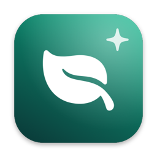
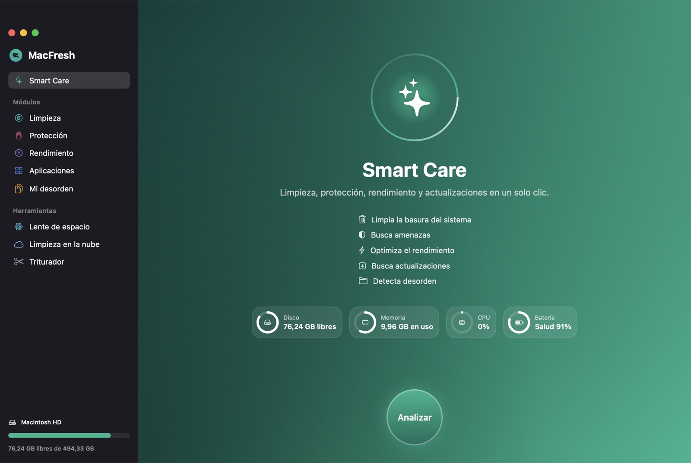
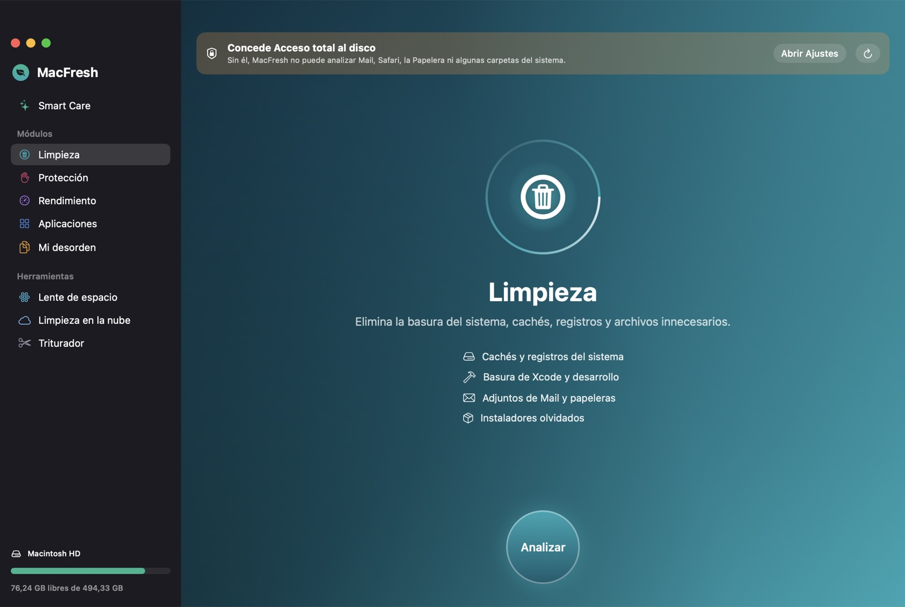
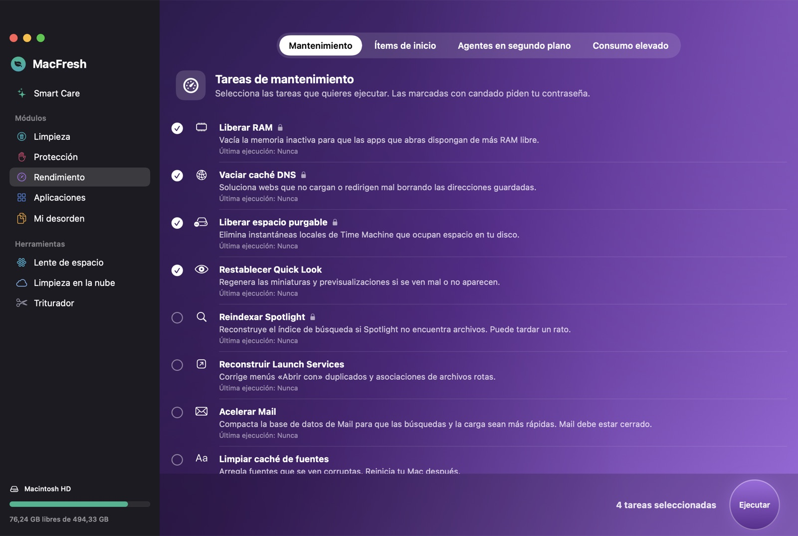
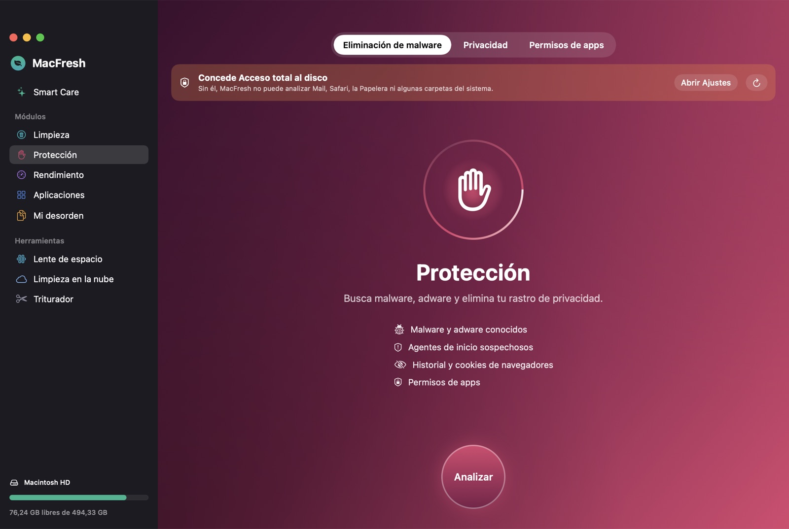
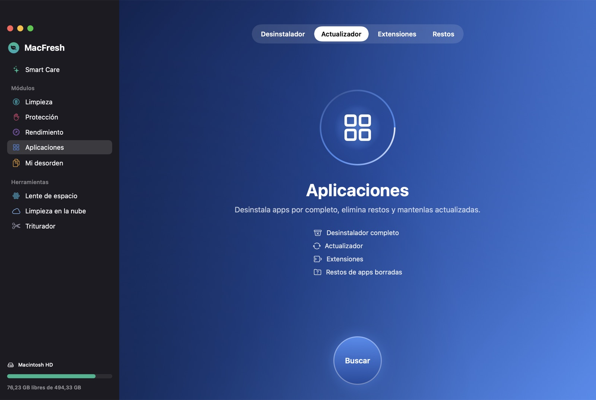
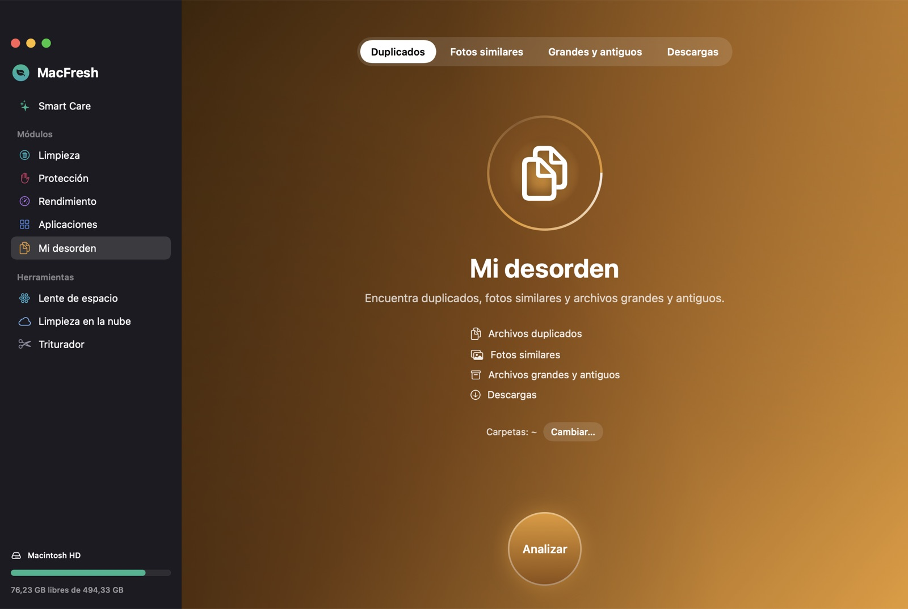
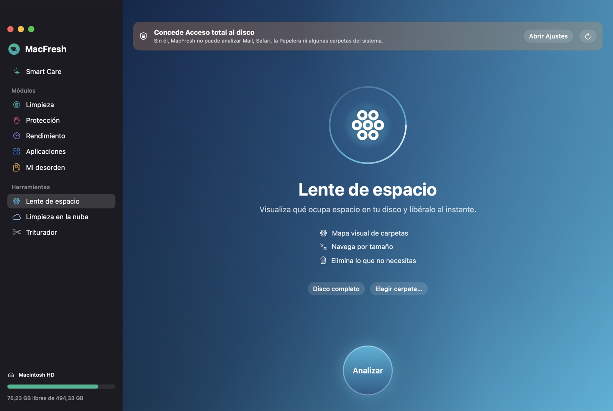
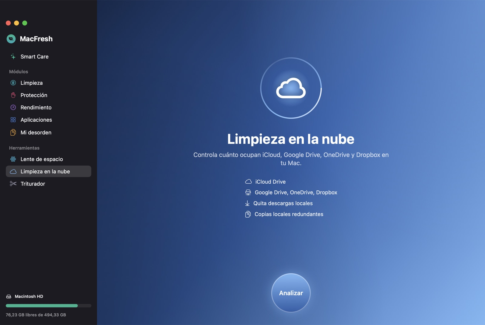
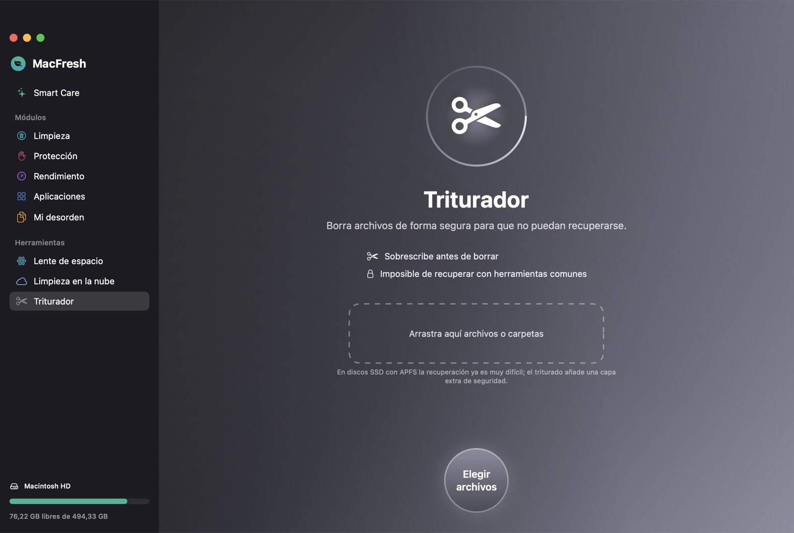

<div align="center">



# MacFresh

**Limpiador y optimizador para Mac gratuito y de código abierto: una alternativa nativa en SwiftUI a CleanMyMac.**

Limpia basura, elimina malware, desinstala apps por completo, encuentra duplicados y visualiza tu disco.
100 % local · sin cuenta · sin telemetría · sin suscripción.

[](#-instalación)
[](https://swift.org)
[](#️-tecnología)
[](LICENSE)
[](#-idiomas)

[English](README.md) · **Español**



</div>

---

## ✨ ¿Por qué MacFresh?

| | MacFresh |
|---|---|
| 💸 **Precio** | Gratis para siempre (licencia MIT) |
| 🔒 **Privacidad** | Todo se ejecuta en tu Mac. Sin cuenta, sin analíticas y sin conexiones salvo las comprobaciones de actualizaciones que tú inicias |
| 🧠 **Nativa** | Swift + SwiftUI puro, ~1 % de CPU en reposo, Apple Silicon e Intel |
| 🛟 **Segura por diseño** | Las rutas críticas del sistema están protegidas, tus archivos van a la Papelera y todo se revisa antes de actuar |
| 🌍 **Bilingüe** | Español e inglés, según el idioma de tu Mac |

## 🧩 Funciones

### ✨ Smart Care
Un solo análisis que ejecuta limpieza, detección de amenazas, mantenimiento, búsqueda de actualizaciones y detección de desorden, y aplica con un clic todo lo que apruebes.

### 🧹 Limpieza


- Cachés de usuario y de apps con sandbox
- Registros de usuario e informes de diagnóstico
- **Basura de Xcode**: DerivedData, soporte de dispositivos antiguos, cachés del simulador y archivos
- **Cachés de desarrollo**: npm, pnpm, Yarn, Gradle, pip, Cargo, Bun, Go, CocoaPods y NuGet
- Instaladores olvidados (`.dmg`, `.pkg`, `.xip`, `.iso`)
- Adjuntos de Mail, copias de iPhone/iPad y estados de apps guardados
- Papelera

<br clear="right"/>

### 🛡️ Protección
- **Eliminación de malware y adware**: base de firmas de familias conocidas de adware y software no deseado para Mac, más heurísticas sobre agentes y daemons de inicio (ubicaciones ocultas o temporales, falsos componentes de Apple, binarios sin firma que se inician solos y elementos rotos).
- **Privacidad**: historial, cookies y cachés de Safari, Chrome, Brave, Edge, Arc, Vivaldi, Opera y Firefox; listas de elementos recientes; registro de descargas del sistema; historial de Terminal.
- **Permisos de apps**: descubre qué apps pueden usar tu cámara, micrófono, pantalla, archivos, contactos… y revoca el acceso.

### ⚡ Rendimiento


- **Mantenimiento**: liberar RAM, vaciar la caché DNS, liberar espacio purgable (instantáneas locales), restablecer Quick Look, reindexar Spotlight, reconstruir Launch Services, acelerar Mail, limpiar la caché de fuentes, reparar permisos de usuario y verificar el disco de arranque.
- **Ítems de inicio**: añade o quita apps que se abren al iniciar sesión.
- **Agentes en segundo plano**: activa, desactiva o elimina agentes y daemons.
- **Consumo elevado**: lista en vivo de los procesos que más CPU y memoria usan.

<br clear="right"/>

### 📦 Aplicaciones
- **Desinstalador** que encuentra todos los restos (Application Support, Caches, Preferences, Containers, Group Containers, agentes de inicio, helpers privilegiados…) y opción de **restablecer app**.
- Filtro de apps **sin usar en 90 días**.
- **Actualizador** para apps de la App Store y apps con Sparkle. Las actualizaciones de Sparkle se descargan e instalan **solo si la firma del desarrollador (Team ID) coincide** con la de la app instalada.
- **Extensiones**: paneles de ajustes, plug-ins de internet, Quick Look, Spotlight y audio, y extensiones de Safari, Finder y Compartir.
- **Restos** de apps que ya borraste.

### 🗂️ Mi desorden
- **Duplicados**: comparación SHA-256 por etapas (tamaño → primeros 16 KB → contenido completo). El original se conserva automáticamente.
- **Fotos similares**: visión artificial en el propio Mac (Apple Vision) que agrupa ráfagas y fotos casi idénticas; se conserva la mejor.
- **Archivos grandes y antiguos**: filtra por tamaño, tipo y última apertura.
- **Descargas**: revisa y limpia tu carpeta de Descargas.

### 🔭 Lente de espacio
Mapa de burbujas interactivo de tu carpeta de inicio, de cualquier carpeta o del disco entero. Entra en las carpetas y elimina lo que no necesites.

### ☁️ Limpieza en la nube
iCloud Drive, Google Drive, OneDrive, Dropbox y Box: espacio local frente a la nube, **quitar descargas locales** sin borrar los archivos de la nube y detección de **copias locales redundantes** de archivos que ya están en la nube.

### ✂️ Triturador
Sobrescribe los archivos con datos aleatorios antes de borrarlos. Admite arrastrar y soltar.

### 📊 Barra de menús
Disco, memoria (con botón *Liberar*), CPU con el proceso que más consume, carga, salud y ciclos de la batería, velocidad de red y tiempo encendido, además de un aviso cuando queda poco espacio.

## 🖼️ Capturas

| | |
|---|---|
|  |  |
|  |  |
|  |  |

## 🚀 Instalación

### Descarga (lo más fácil)

1. Descarga **`MacFresh-x.y.z.zip`** desde la [última versión publicada](https://github.com/devbleras/macfresh/releases/latest).
2. Descomprímelo y arrastra **MacFresh.app** a **Aplicaciones**.
3. Ábrela. Como MacFresh es gratuita y no está notarizada por Apple, macOS te avisará la primera vez:
   - **macOS 15 Sequoia o posterior:** abre **Ajustes del Sistema → Privacidad y seguridad**, baja hasta el final y pulsa **Abrir igualmente** junto a MacFresh.
   - **macOS 14 Sonoma:** clic derecho en MacFresh.app → **Abrir** → **Abrir**.
   - O desde Terminal:
     ```bash
     xattr -dr com.apple.quarantine /Applications/MacFresh.app
     ```

App universal: funciona de forma nativa en Mac con Apple Silicon e Intel con macOS 14 o posterior.

### Compilar desde el código

Requisitos: macOS 14+ y Xcode 15.3+ (o las herramientas de línea de comandos de Swift 5.10+: `xcode-select --install`).

```bash
git clone https://github.com/devbleras/macfresh.git
cd macfresh
./scripts/build-app.sh
open build/MacFresh.app
```

Para instalarla como cualquier otra app, arrastra `build/MacFresh.app` a `/Aplicaciones`.
Para publicar una versión, `./scripts/release.sh <versión>` genera el zip universal.

### Concede Acceso total al disco (recomendado)
Para analizar Mail, Safari, la Papelera y los permisos de apps, activa MacFresh en
**Ajustes del Sistema → Privacidad y seguridad → Acceso total al disco**. Si falta, MacFresh muestra un aviso con un acceso directo.

## 🛟 Seguridad

- Las ubicaciones del sistema (`/System`, `/usr`, la propia `~/Library`, los llaveros, tus carpetas de usuario…) nunca se pueden eliminar.
- **Tus archivos personales van a la Papelera**; solo las cachés, los registros y los rastros de privacidad se borran directamente.
- Todo se muestra para revisarlo antes de eliminar nada; no ocurre nada de forma automática.
- Añade tus propias **exclusiones** en *Ajustes (⌘,) → Exclusiones*.
- Las tareas que necesitan permisos de administrador piden la contraseña **una sola vez por lote**, con el diálogo estándar de macOS.
- El Triturador avisa de que en SSD con APFS sobrescribir es una capa extra, no una garantía.

## 🌍 Idiomas

MacFresh sigue el idioma preferido de tu Mac: **español** si lo tienes como preferido e **inglés** en cualquier otro caso.
¿Quieres añadir un idioma? Las traducciones están en [`scripts/l10n/en.py`](scripts/l10n/en.py) (las claves son los textos en español). Ejecuta:

```bash
python3 scripts/l10n/build_strings.py
```

Avisa de las traducciones que falten y regenera `Resources/*.lproj`.

## 🛠️ Tecnología

- Swift + SwiftUI (Observation) y Swift Package Manager, sin dependencias externas
- `Vision` para fotos similares, `CryptoKit` para duplicados, `IOKit` para la salud de la batería y `Security` para verificar firmas de código
- Diagnóstico de solo lectura: `swift build && .build/debug/MacFresh --selftest`
- Capturas del README: `./scripts/screenshots.sh`

```
Sources/MacFresh/
├── App/        entrada de la app, ventana principal, barra de menús y ajustes
├── Core/       sistema de archivos, shell, monitor del sistema y localización
├── UI/         tema y componentes compartidos
└── Modules/    SmartCare, Cleanup, Protection, Performance, Applications,
                Clutter, SpaceLens, Cloud, Shredder
```

## 🤝 Contribuir

Se agradecen issues y pull requests, sobre todo nuevas ubicaciones de basura, firmas de malware, traducciones y mejoras de interfaz.
Respeta las reglas de seguridad: nunca borrar sin revisión, preferir la Papelera y no tocar rutas del sistema.

## 📄 Licencia

[MIT](LICENSE) © 2026 colaboradores de MacFresh.

<sub>MacFresh es un proyecto independiente y no está afiliado, respaldado ni relacionado con MacPaw. CleanMyMac es una marca registrada de MacPaw Way Ltd.</sub>

<!-- Palabras clave: limpiador mac, limpiar mac gratis, alternativa a cleanmymac, cleanmymac gratis, desinstalador de apps mac, buscar duplicados mac, analizador de disco mac, eliminar malware mac -->
