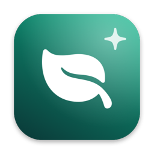
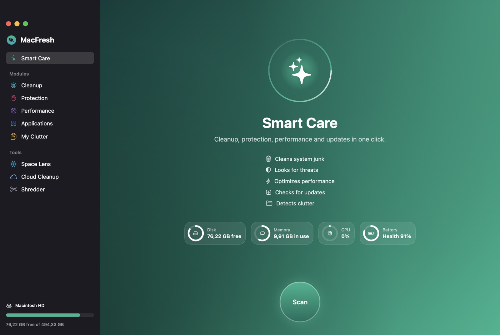
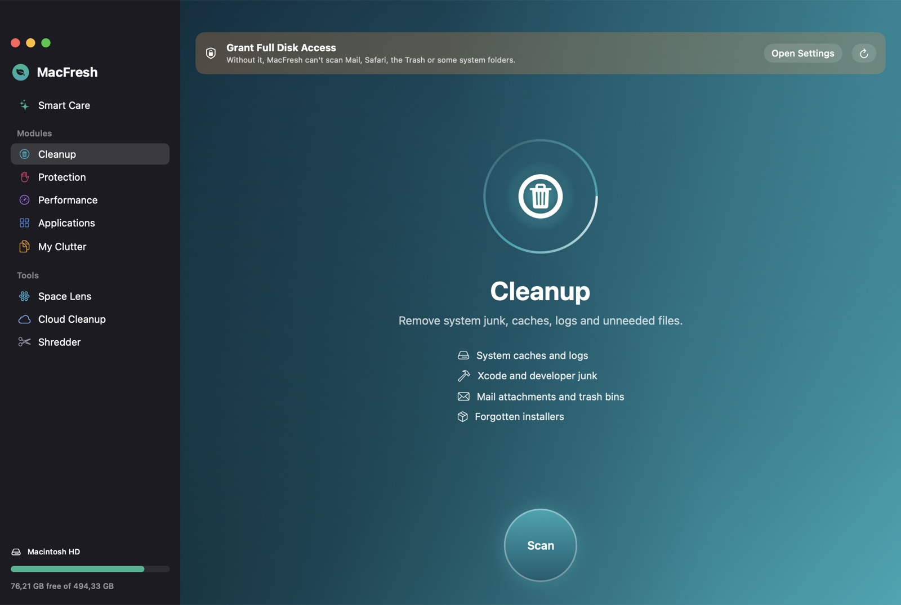
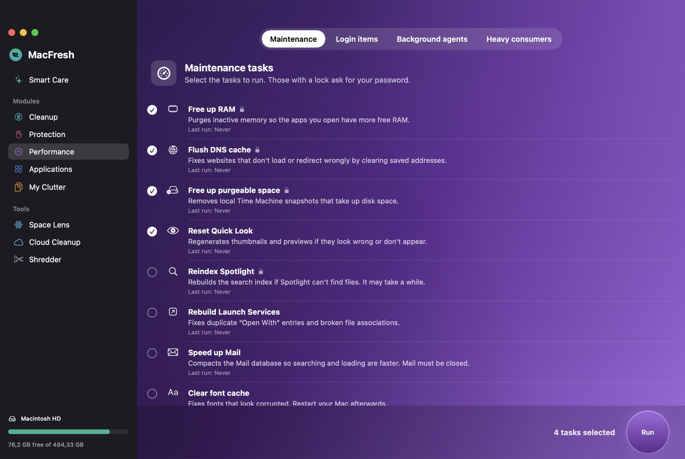
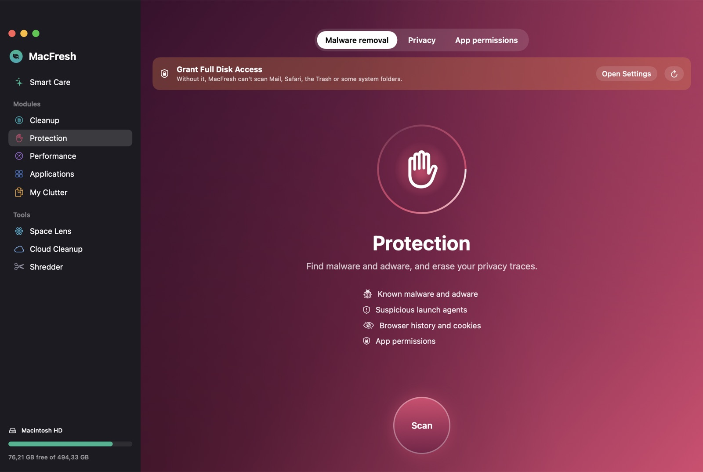
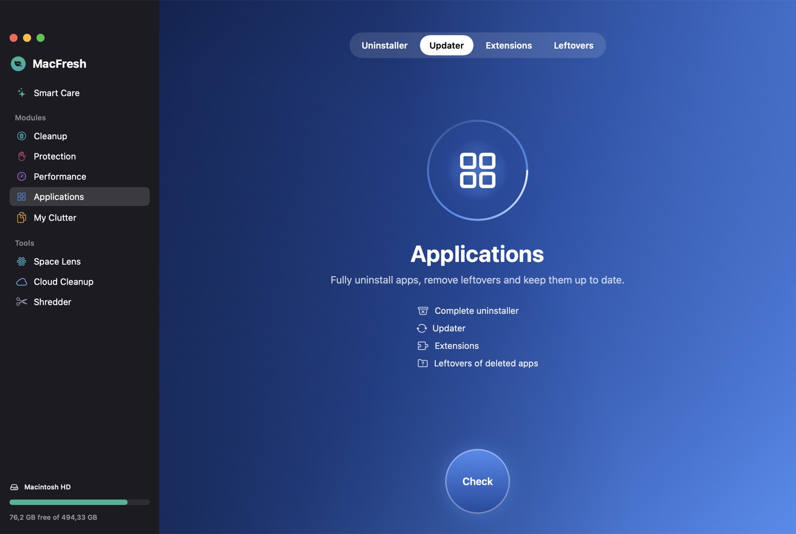
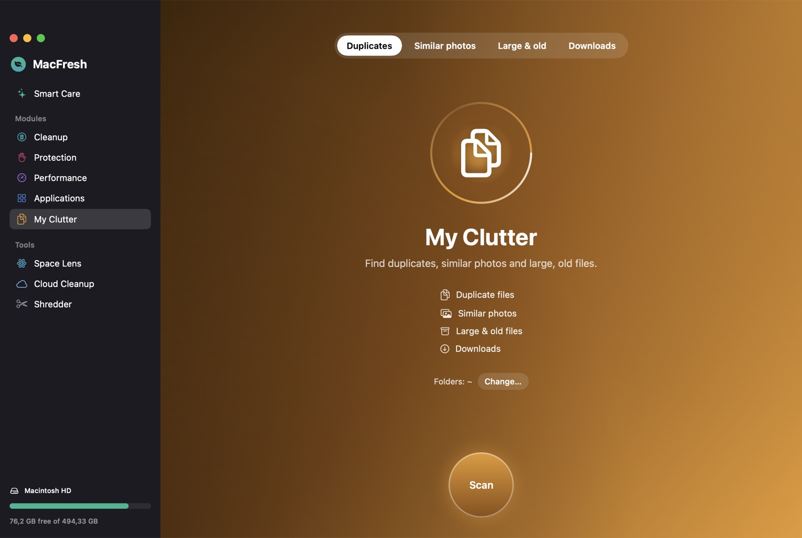
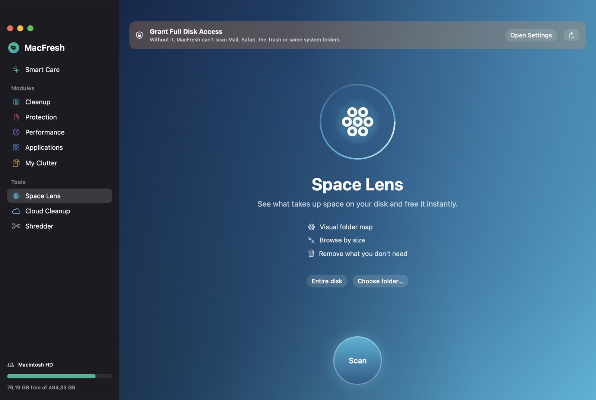
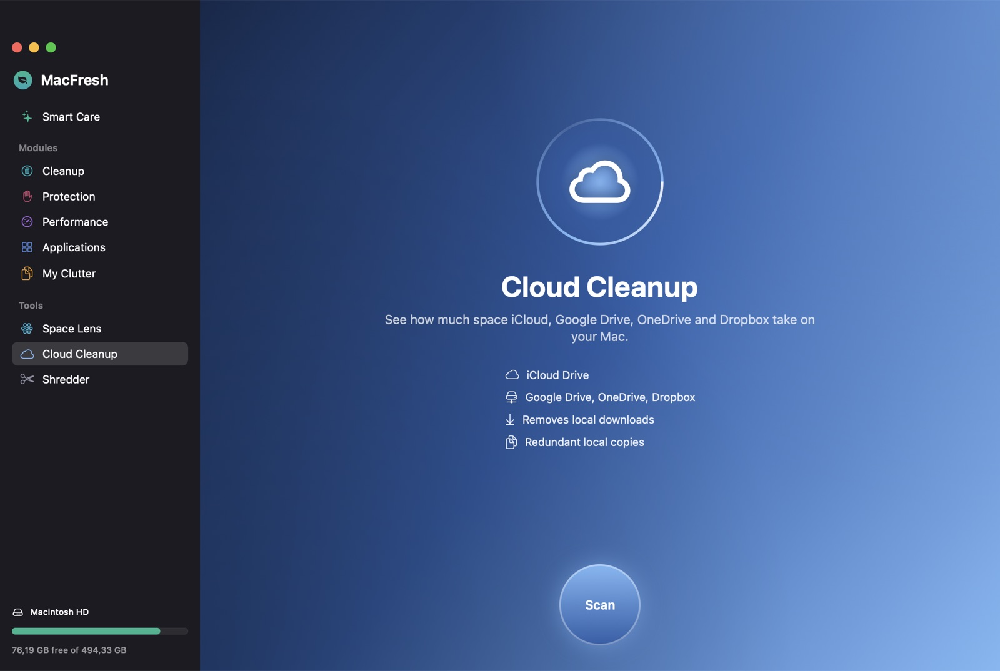
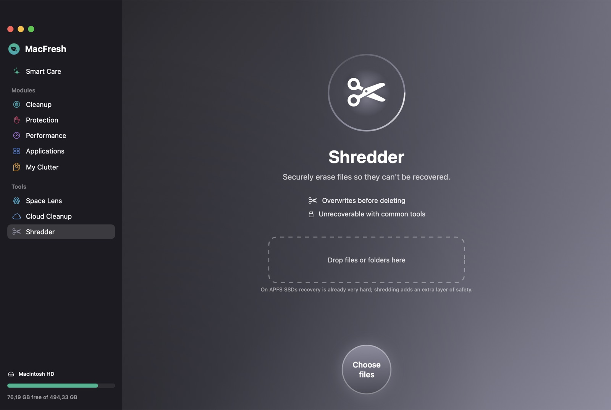

<div align="center">



# MacFresh

**Free, open-source Mac cleaner & optimizer — a native SwiftUI alternative to CleanMyMac.**

Clean junk, remove malware, uninstall apps completely, find duplicates and visualize your disk.
100% local · no account · no telemetry · no subscription.

[](#-installation)
[](https://swift.org)
[](#-tech)
[](LICENSE)
[](#-languages)

**English** · [Español](README.es.md)



</div>

---

## ✨ Why MacFresh?

| | MacFresh |
|---|---|
| 💸 **Price** | Free forever (MIT licensed) |
| 🔒 **Privacy** | Everything runs on your Mac. No account, no analytics, no network calls except update checks you start |
| 🧠 **Native** | Pure Swift + SwiftUI, ~1 % CPU idle, Apple Silicon & Intel |
| 🛟 **Safe by design** | Critical system paths are protected, personal files go to the Trash, every action is reviewable |
| 🌍 **Bilingual** | English & Spanish, follows your Mac's language |

## 🧩 Features

### ✨ Smart Care
One scan that runs cleanup, threat detection, maintenance, update checks and clutter detection — then fixes everything you approve with a single click.

### 🧹 Cleanup


- User & sandboxed app caches
- User logs and diagnostic reports
- **Xcode junk**: DerivedData, old device support, simulator caches, archives
- **Developer caches**: npm, pnpm, Yarn, Gradle, pip, Cargo, Bun, Go, CocoaPods, NuGet
- Forgotten installers (`.dmg`, `.pkg`, `.xip`, `.iso`)
- Mail attachments, iPhone/iPad backups, saved app states
- Trash

<br clear="right"/>

### 🛡️ Protection
- **Malware & adware removal**: signature database of known Mac adware/PUP families plus heuristics on launch agents and daemons (hidden or temporary locations, fake Apple components, unsigned auto-starting binaries, broken items).
- **Privacy**: history, cookies and caches of Safari, Chrome, Brave, Edge, Arc, Vivaldi, Opera and Firefox; recent items lists; system download log; Terminal history.
- **App permissions**: see which apps can use your camera, microphone, screen, files, contacts… and revoke access.

### ⚡ Performance


- **Maintenance**: free up RAM, flush DNS, free purgeable space (local snapshots), reset Quick Look, reindex Spotlight, rebuild Launch Services, speed up Mail, clear font cache, repair user permissions, verify startup disk.
- **Login items**: add or remove apps that open at login.
- **Background agents**: enable, disable or delete launch agents & daemons.
- **Heavy consumers**: live list of the processes using the most CPU and memory.

<br clear="right"/>

### 📦 Applications
- **Uninstaller** that finds every leftover (Application Support, Caches, Preferences, Containers, Group Containers, Launch Agents, privileged helpers…), plus **Reset app**.
- Filter apps **unused for 90 days**.
- **Updater** for App Store apps and Sparkle-based apps. Sparkle updates are downloaded and installed **only if the developer signature (Team ID) matches** the installed app.
- **Extensions**: settings panes, internet/Quick Look/Spotlight/audio plug-ins, Safari, Finder and Share extensions.
- **Leftovers** of apps you already deleted.

### 🗂️ My Clutter
- **Duplicates** — staged SHA-256 comparison (size → first 16 KB → full content). The original is kept automatically.
- **Similar photos** — on-device computer vision (Apple Vision) groups bursts and near-identical shots; the best one is kept.
- **Large & old files** — filter by size, kind and last-opened date.
- **Downloads** — review and clean your Downloads folder.

### 🔭 Space Lens
Interactive bubble map of your home folder, any folder or the whole disk. Drill into folders and remove what you don't need.

### ☁️ Cloud Cleanup
iCloud Drive, Google Drive, OneDrive, Dropbox and Box: local vs. cloud usage, **remove local downloads** while keeping files in the cloud, and find **redundant local copies** of files that are already in the cloud.

### ✂️ Shredder
Overwrites files with random data before deleting them. Drag & drop supported.

### 📊 Menu bar
Disk, memory (one-click *Free up*), CPU with top process, battery charge, health and cycle count, network speed and uptime — plus a low-disk-space notification.

## 🖼️ Screenshots

| | |
|---|---|
|  |  |
|  |  |
|  |  |

## 🚀 Installation

### Download (easiest)

1. Download **`MacFresh-x.y.z.zip`** from the [latest release](https://github.com/devbleras/macfresh/releases/latest).
2. Unzip it and drag **MacFresh.app** into **Applications**.
3. Open it. Because MacFresh is free and not notarized by Apple, macOS will warn you the first time:
   - **macOS 15 Sequoia or later:** open **System Settings → Privacy & Security**, scroll down and click **Open Anyway** next to MacFresh.
   - **macOS 14 Sonoma:** right-click MacFresh.app → **Open** → **Open**.
   - Or from Terminal:
     ```bash
     xattr -dr com.apple.quarantine /Applications/MacFresh.app
     ```

Universal app: runs natively on Apple Silicon and Intel Macs with macOS 14 or later.

### Build from source

Requirements: macOS 14+ and Xcode 15.3+ (or the Swift 5.10+ command-line tools: `xcode-select --install`).

```bash
git clone https://github.com/devbleras/macfresh.git
cd macfresh
./scripts/build-app.sh
open build/MacFresh.app
```

To install it like any other app, drag `build/MacFresh.app` into `/Applications`.
Maintainers can create a universal release zip with `./scripts/release.sh <version>`.

### Grant Full Disk Access (recommended)
To scan Mail, Safari, the Trash and app permissions, enable MacFresh in
**System Settings → Privacy & Security → Full Disk Access**. MacFresh shows a banner with a shortcut when it's missing.

## 🛟 Safety

- System locations (`/System`, `/usr`, `~/Library` itself, Keychains, your user folders…) can never be removed.
- **Personal files go to the Trash**; only caches, logs and privacy traces are deleted directly.
- Everything is listed for review before anything is removed — nothing happens automatically.
- Add your own **exclusions** in *Settings (⌘,) → Exclusions*.
- Tasks that need administrator rights ask for your password **once per batch**, through the standard macOS dialog.
- The Shredder warns that on APFS SSDs overwriting is an extra layer, not a guarantee.

## 🌍 Languages

MacFresh follows your Mac's preferred language: **Spanish** if Spanish is preferred, **English** otherwise.
Want to add a language? Translations live in [`scripts/l10n/en.py`](scripts/l10n/en.py) (keys are the Spanish source strings). Run:

```bash
python3 scripts/l10n/build_strings.py
```

It reports any missing translation and regenerates `Resources/*.lproj`.

## 🛠️ Tech

- Swift + SwiftUI (Observation), Swift Package Manager — no third-party dependencies
- `Vision` for similar photos, `CryptoKit` for duplicates, `IOKit` for battery health, `Security` for code-signature checks
- Read-only diagnostics: `swift build && .build/debug/MacFresh --selftest`
- README screenshots: `./scripts/screenshots.sh`

```
Sources/MacFresh/
├── App/        app entry, main window, menu bar, settings
├── Core/       file system helpers, shell, system monitor, localization
├── UI/         theme and shared components
└── Modules/    SmartCare, Cleanup, Protection, Performance, Applications,
                Clutter, SpaceLens, Cloud, Shredder
```

## 🤝 Contributing

Issues and pull requests are welcome — new junk locations, malware signatures, translations and UI polish especially.
Please keep the safety rules above: never delete without review, prefer the Trash, never touch system paths.

## 📄 License

[MIT](LICENSE) © 2026 MacFresh contributors.

<sub>MacFresh is an independent project and is not affiliated with, endorsed by or connected to MacPaw. CleanMyMac is a trademark of MacPaw Way Ltd.</sub>

<!-- Keywords: mac cleaner, macos cleaner, cleanmymac alternative, free cleanmymac, open source mac cleaner, app uninstaller mac, duplicate finder mac, disk space analyzer mac, malware remover mac, swiftui app -->
